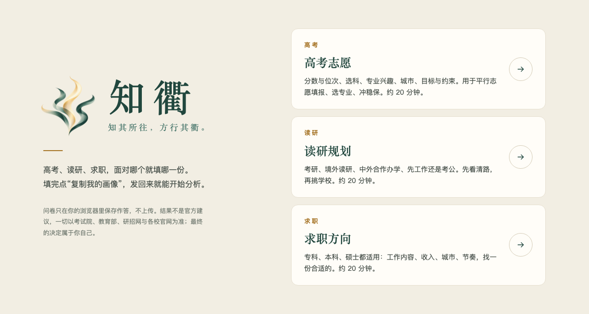
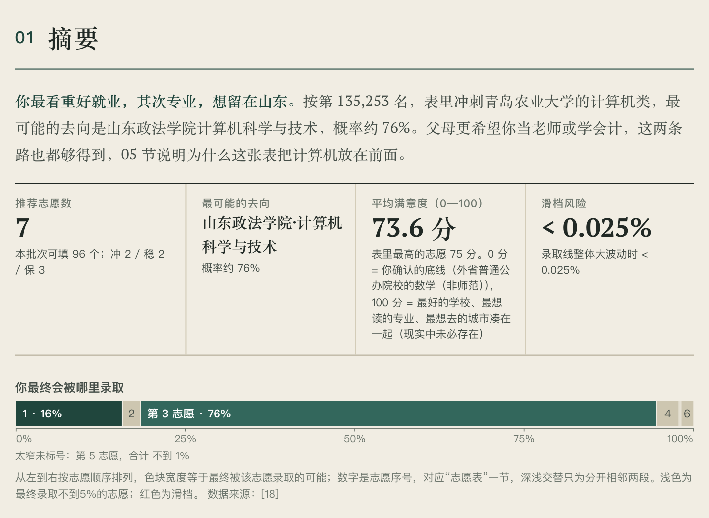
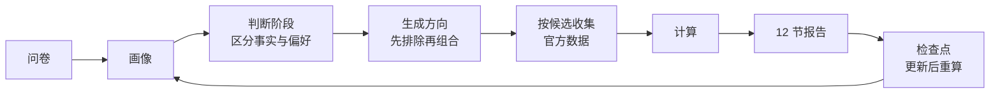

<p align="center"></p>

<h1 align="center">知衢 Zhiqu</h1>

<p align="center"><b>面向高考、读研与求职的发展规划技能</b><br>知其所往，方行其衢。</p>

<p align="center">
  <a href="https://wjsgzz.github.io/Zhiqu/"></a>
  
  
  
  <a href="LICENSE"></a>
</p>

<p align="center"></p>

高考填志愿、要不要考研、该接哪个 offer，这几个路口一步走错，往往要用好几年来补。知衢是装在 AI 助手（Claude Code、Codex 等）上的一组规划技能：你花约 15 分钟填一份问卷，AI 读懂你是谁、想要什么、有哪些硬条件，再查官方公开数据，把每条路算给你看——通向哪里、有多大把握、要付出什么、失败了退到哪、什么时候该再看一次。最后交付一份固定 12 节的报告。

- **按你自己的排序算。** 学校、专业、城市、前景谁更重要，由你排；满意度按你的排序换算，不按别人的标准替你选。
- **概率经得起回头看。** 高考版用往年数据预测下一年，再拿真实录取结果对照，每个省的准确程度都公开评级。
- **没依据就不编数字。** 读研、求职拿不到可靠数据时，只给分数情景和收入测算，不给“你有 X% 的把握”。

[案例](#案例) · [快速开始](#快速开始) · [工作原理](#工作原理) · [数据与可信度](#数据与可信度) · [局限](#局限)

## 功能

| 场景 | 回答的问题 | 核心产出 |
|---|---|---|
| **高考** | 志愿怎么填 | 按各省官方投档位次预测录取线，计算每个志愿的录取概率与滑档风险，优化整张志愿表并生成填报单 |
| **读研** | 考研、境外读研、中外合作办学、先工作还是考公 | 路径比较；把可能的初试分数放进目标院校往年录取分布对照；时间线与检查点 |
| **求职** | 找什么工作，选哪个 offer | 按兴趣、能力与收入底线生成职业方向；测算到手收入、时薪与扣除房租后的月结余；合同与权益风险 |
| **八字**（可选） | 传统视角的自我对照 | 问卷内排盘；与性格自评、现实条件三方对照，不参与打分与排序 |

**原则**
- 只用官方公开数据，标明年份与来源。
- 高考概率在有位次数据的省份经留出年份检验；读研和求职没有依据时只做情景比较，不编百分比。
- 给路线图，不代写文书、不改简历、不代为填报。
- 按阶段更新：出分、拿到 offer 等节点重新计算。

## 案例

人是模拟的，数据是真的。我们设计了十二位模拟考生，分布在浙江、山东、河北、江苏、湖北：
- **家庭**：普通家庭、复读生、高分考生、卡在本科线边缘的考生、不缺学费的家庭。
- **做法**：每人的分数事先定好，排志愿表只用 2025 年及以前的官方数据。排完再拿 2026 年各省考试院公布的真实投档线逐条对照，看他最后会被哪里录取。
- **登记**：设定在读取 2026 年数据之前写定并存档，结果不好也照实写。

**能判定的 8 个案例全部被录取，没有滑档，其中 7 个正好落在报告预测最可能的那个志愿。**另有 4 个“无法判定”：报告里的部分志愿 2026 年在投档表里对不上号，主要是江苏、湖北的专业组每年重新编号。

### 小雅 · 山东 · 普通家庭

> 分数中等，不知道学什么好：计算机、会计、当老师都想过。哪个好就业，又是我能上的？

父亲在潍坊的机械厂做技术员，母亲在超市做会计，家里一年收入合计约 15 万，还有一个上初中的弟弟。530 分，全省第 135,204 名。父母希望她当老师或学会计，稳定，离家近。

- **按她自己的排序**：就业第一、专业第二、城市第三。计算机的前景分比师范只高半分，在她的排序下就拉开了约 10 分，所以表以计算机为主。报告写明了这半分怎么改、改了以后表会怎么变。
- **7 个志愿**：冲刺青岛农业大学的计算机类，最可能落在山东政法学院计算机科学与技术（约 76%），保底是山东女子学院的软件和数据科学。
- **2026 年真实结果**：两个冲刺没过，第 3 志愿山东政法学院计算机录取，余量约一万五千名，正是预测最可能的去向。



[小雅的完整报告](skills/zhiqu/examples/2026-GK-R12/report.pdf) · [画像](skills/zhiqu/examples/2026-GK-R12/profile.txt)

### 另外几位

| 考生 | 情况 | 2026 年真实结果 |
|---|---|---|
| **小磊** · 山东 · 复读生 | 去年 512 分，复读后 548 分；只想学临床 | 第 1 志愿济宁医学院临床医学，正是预测最可能的去向（约 84%） |
| **一诺** · 河北 · 高分 | 物理类第 4,538 名；想在北京读计算机 | 6 个冲刺都没过，落在中央财经大学计算机类，正是预测最可能的去向（约 57%）；其中 1 个冲刺志愿 2026 年对不上号，严格记为“无法判定” |
| **浩然** · 河北 · 卡在边缘 | 历史类第 34,678 名；想考公，只要公办 | 前 20 个志愿都没过，落在第 21 个，和录取线同分。只填前一半就滑档了 |
| **俊杰** · 江苏 · 不缺学费 | 父母要名校，他对专业没想法 | 无法判定：40 个专业组志愿只有 16 个能和 2026 年对上号 |

**[全部 12 个案例 →](CASES.md)** 还包括读研（小林，考华南理工电气专硕）和求职（小宁，四川高职会计比较两个 offer）的示例。

## 快速开始

### 1. 安装

需要 Python 3.10 或更高版本；生成 PDF 需要本机安装 Chrome、Edge 或 Chromium（没有时输出 HTML）。脚本只用 Python 标准库，无需 `pip install`。

```bash
git clone --depth 1 https://github.com/WJSGZZ/Zhiqu.git
cd Zhiqu

DEST=~/.claude/skills        # Codex 使用 ~/.codex/skills
mkdir -p "$DEST"
for s in zhiqu zhiqu-grad zhiqu-career bazi zhiqu-shared; do
  if [ -e "$DEST/$s" ]; then echo "已存在 $DEST/$s，未覆盖"; else cp -R "skills/$s" "$DEST/$s"; fi
done
```

四个技能与 `zhiqu-shared` 共用目录必须安装在同一目录下，它们通过相对路径引用共用资料。读研和求职读取共用规则时无需加载高考数据；高考专用统计与工具按场景另读。常用的技能目录：

| Agent | 个人安装 | 项目内安装 |
|---|---|---|
| Claude Code | `~/.claude/skills/` | `<项目>/.claude/skills/` |
| Codex | `~/.codex/skills/` | 按 Codex 文档 |
| 其他支持 `SKILL.md` 的 Agent | 按其文档 | 按其文档 |

验证安装：

```bash
cd "$DEST/zhiqu"
python3 scripts/optimize.py examples/candidates_demo.csv --rank 30000 --slots 12 --u-fall -60
```

输出一张探索用志愿表后，再运行 `python3 scripts/check_demos.py`，验证三版示例及八字依赖。`check_family.py` 是仓库级检查，需在含问卷的完整仓库中运行。正式填报须使用已核实资格证据与 `--decision-mode formal --target-year 年份`；示例只演示计算。更新时先 `git pull`，删除旧的四技能及共用目录后重新复制。

### 2. 填写问卷

打开[在线问卷](https://wjsgzz.github.io/Zhiqu/)，选择高考、读研或求职。完成后点击"生成我的画像"并复制。画像以 `【高考志愿 · 自我盘点】`、`【读研 · 自我盘点】` 或 `【求职 · 自我盘点】` 开头，Agent 据此选择技能。作答只保存在浏览器本地。

### 3. 生成报告

把画像发给已安装技能的 Agent，并说明当前阶段和想解决的问题：

```text
这是我的知衢画像。我是 2027 年浙江考生，已出分，位次 58000。
请核实当年招生计划与选考要求，先让我确认专业偏好和调剂态度，再计算志愿表。
【高考志愿 · 自我盘点】
……
```

Agent 会追问影响结论的缺项，查询官方数据，输出 HTML 与 PDF 报告。报告第一页是结论和下一步。

## 部署问卷

问卷是静态网页，不需要后端：

- **GitHub Pages**：Fork 本仓库，在 Settings → Pages 中选择 `main` 分支根目录，访问 `https://<用户名>.github.io/Zhiqu/`。
- **本地**：直接用浏览器打开 `index.html`。

八字排盘从 jsDelivr 加载 [lunar-javascript](https://github.com/6tail/lunar-javascript)；无法联网时，问卷其余部分照常使用，出生信息原样写入画像，由 Agent 排盘。

## 工作原理



**高考**：在位次的对数空间预测录取线：以上一年为主、加近年加权，叠加全省漂移；按位次段、历史长度和是否跳变区分波动。用蒙特卡洛模拟共同波动下的录取结果，以贪心加交换的方法选出期望满意度最高、滑档概率受限的组合。满意度由考生自己的优先级排序换算权重，0 分和 100 分锚定在本人确认的两个选项上。各省参数只用本省数据，在留出年份检验。

**读研与求职**：没有统一的全国数据库，确定方向后按候选收集数据。读研以官方拟录取名单的分数分布做情景对照；求职以人社部门工资价位作群体参考，按个税与社保规则测算 offer。

详见[模型说明](skills/zhiqu/references/volunteer-game.md)与[回测记录](skills/zhiqu/references/backtests.md)。

## 数据与可信度

- **高考**：浙江、山东、河北、江苏、湖北、湖南、福建、广东、山西、辽宁、上海、黑龙江 12 省的官方投档数据，除辽宁外都配有一分一段表；河南只有一分一段表；十个重点省份另有 2027 届适用的选考科目要求表（山西 2027 版未找到）。全部整理为 CSV，各省目录注明来源与口径（[数据说明](skills/zhiqu/data/README.md)、[已知缺口](skills/zhiqu/references/public-data-gaps.md)）。

十个重点省份逐省、逐科类做过“回头看”：每一年只用此前的数据预测，再对照当年的官方位次，按结果评级（[评级方法与逐年明细](skills/zhiqu/data/calibration/README.md#十省可信度体检2026-10-16)）。

| 等级 | 含义 | 省份 |
|---|---|---|
| A | 说“八成把握”的区间，回头看大约八成真的落在里面；说“95% 稳”的，失手不超过 7% | 山东、河北、江苏（物理类）、湖北 |
| B | 基本吻合，误差略大，报告会写明 | 浙江、江苏（历史类）、福建、湖南、广东 |
| C | 新高考只考了两年，检验次数太少 | 山西 |
| D | 官方投档表只在需登录的平台，没有收录，无法检验 | 河南 |

数据少的省份照样能排表：程序会把不确定性算大，自动多留保底余量，报告写明这份表为什么更保守、代价是什么（[做法与检验](skills/zhiqu/references/backtests.md)）。
- **读研、求职**：教育部与研招网规定、院校拟录取名单、人社部门工资价位与最低工资、劳动法规，按需查询并记录来源。
- 验证码、登录和人机验证一律不绕过，记为缺口。会过期的事实标注复核期限。

## 项目结构

```
index.html · gaokao.html · grad.html · career.html   问卷
skills/
├── zhiqu-shared/   共用资料与检查器（不是独立技能）
├── zhiqu/          高考技能：数据、预测、优化、报告、检查脚本
├── zhiqu-grad/     读研技能
├── zhiqu-career/   求职技能
└── bazi/           八字技能：排盘引擎与解盘方法
AGENTS.md           贡献者（含 AI Agent）工作规范
```

## 开发

```bash
python3 -m unittest discover -s skills/zhiqu/tests    # 单元测试
python3 skills/zhiqu/scripts/check_family.py          # 引用、问卷节名、报告结构、复核期限
python3 skills/zhiqu/scripts/check_demos.py           # 复现三个示例的排盘与计算
python3 skills/zhiqu/scripts/validate_data.py         # 数据校验
```

参与开发前请阅读 [AGENTS.md](AGENTS.md)。

能力与验证范围：

| 范围 | 已有验证 | 尚不能据此证明 |
|---|---|---|
| 高考投档模型 | 按省、科类复算历史预测和示例志愿表 | 某位考生必录、组内专业或退档风险准确 |
| 三版共用能力 | 证据状态、固定偏好锚点、依赖与报告一致性检查 | 官方条件已被程序完整识别、个人偏好已获确认 |
| 读研与求职 | 分数情景、预算和模拟offer可复算；行动路线有检查点 | 个人上岸概率、就业成功率或真实决策效果 |

## 局限

- 录取概率、分数情景与收入测算都是估计，不保证录取或录用；模拟中未出现滑档不等于没有风险。
- 数据覆盖有限：高考有官方投档数据的是 12 个省，河南只有一分一段表，其他省份要按需现查；读研和求职依赖按需查询。
- 2026 年的回头检验显示，热门方向整体变热时，录取线会比预测更紧；报告会单独给出“再变热”的情况。
- 江苏、湖北这类按“院校专业组”投档的省份，组号和组内专业每年会变，往年的组线只能当参考，填报前必须用当年招生计划逐组核对。
- 八字的现实预测效度未经验证，仅作可选的自我对照。
- 一切以考试院、教育部、各校与用人单位当年的正式文件为准，最终决定由本人作出。

## 许可证

[MIT](LICENSE) © 2026 Xik Pai。可以自由使用、修改、分发和商用，但须在副本中保留原版权声明与许可文本。

第三方组件保留各自的许可证：[lunar-python](skills/bazi/scripts/vendor/LUNAR_PYTHON_LICENSE.txt)（随仓库分发）与 lunar-javascript（问卷在线加载），均为 MIT。招生、工资、政策等数据来自各级政府与院校的公开资料，本仓库只做整理，原始数据的权利属于发布方。
